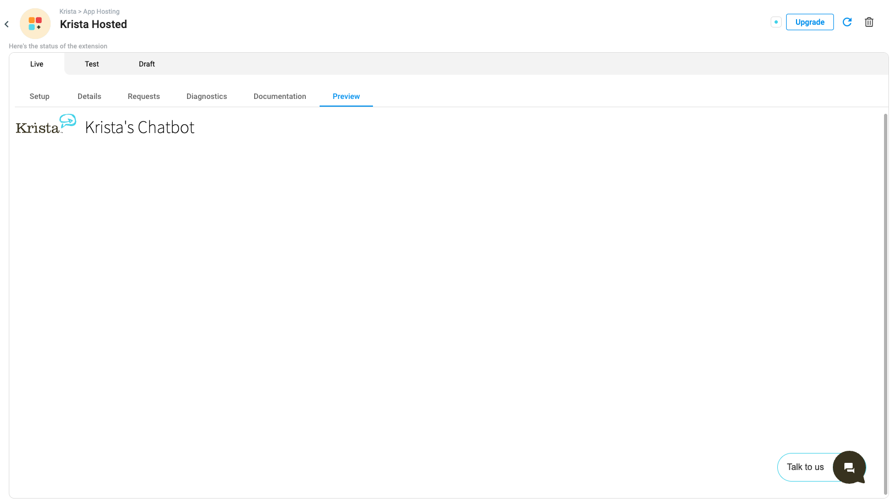

# Context Data Passing

## Overview

The Krista Chatbot Extension allows you to pass contextual data from your hosted website to the chatbot. This enables personalized conversations based on user information, session data, or any other relevant context available on your website. Context data can be used within conversations to provide tailored responses and streamline user interactions.

## How Context Data Works

When you embed the Krista Chatbot on your website, you can pass custom data through the `metadata` property in the chatbot initialization options. This data becomes available to conversations running in the chatbot, allowing you to:

- Personalize greetings and responses
- Pre-fill form fields with known information
- Make context-aware decisions in conversation flows
- Track user-specific information across the session

## Basic Implementation

### Step 1: Include Chatbot Scripts

Add the chatbot stylesheet and script to your HTML page:

```html
<!-- Krista Chatbot Stylesheet -->
<link rel="stylesheet" href="https://your-krista-instance.com/chatbot/ui/launcher.css"/>

<!-- Krista Chatbot Script -->
<script src="https://your-krista-instance.com/chatbot/ui/launcher.js"></script>
```

> **📝 Note**: Replace `https://your-krista-instance.com` with your actual Krista instance URL.

### Step 2: Define Context Data

Create a JavaScript object containing the contextual data you want to pass:

```javascript
const contextData = {
  USER_ID: 12345,
  USER_NAME: "John Doe",
  DEPARTMENT: "Finance",
  ACCOUNT_TYPE: "Premium",
  IS_LOGGED_IN: true
};
```

### Step 3: Initialize Chatbot with Context

Pass the context data through the `metadata` property:

```javascript
const options = {
  position: 'bottomRight',
  host: "https://your-krista-instance.com/chatbot/",
  metadata: contextData, // Pass context variables here
  chatBubble: {
    cssClass: 'bubble-btn',
    icon: `<svg width="60" height="60" viewBox="0 0 60 60" fill="none" xmlns="http://www.w3.org/2000/svg">
      <path fill-rule="evenodd" clip-rule="evenodd" d="M30 0C13.4315 0 0 13.4315 0 30C0 46.5685 13.4315 60 30 60C35.0129 60 39.7387 58.7705 43.8922 56.5965C44.3533 56.3552 44.8874 56.2858 45.3902 56.4205L55.7458 59.1953C57.2329 59.5938 58.5938 58.2329 58.1953 56.7458L55.563 46.9219C55.418 46.3809 55.5096 45.8058 55.7961 45.3245C58.4663 40.8394 60 35.5988 60 30C60 13.4315 46.5685 0 30 0Z" fill="#3F3920"/>
      <path fill-rule="evenodd" clip-rule="evenodd" d="M26 34.0898V37C26 37.5523 26.4477 38 27 38H35.5858C35.851 38 36.1054 38.1054 36.2929 38.2929L38.4879 40.4879C38.6769 40.6769 39 40.543 39 40.2757V32C39 31.4477 38.5523 31 38 31V33C38 33.5523 37.5523 34 37 34H26.4142C26.2699 34 26.1288 34.0312 26 34.0898Z" fill="white"/>
      <path d="M21 23C21 22.4477 21.4477 22 22 22H35C35.5523 22 36 22.4477 36 23V31C36 31.5523 35.5523 32 35 32H24.4142C24.149 32 23.8946 32.1054 23.7071 32.2929L21.5121 34.4879C21.3231 34.6769 21 34.543 21 34.2757V23Z" fill="white"/>
    </svg>`
  }
};

const kristaChatbot = new Chatbot(options);
kristaChatbot.init();
```

The chatbot will appear with the default launch icon:



## Complete Example

Here's a complete HTML example showing context data passing:

```html
<!DOCTYPE html>
<html lang="en">
<head>
  <meta charset="UTF-8">
  <meta name="viewport" content="width=device-width, initial-scale=1.0">
  <title>Krista Chatbot with Context Data</title>

  <!-- Krista Chatbot Stylesheet -->
  <link rel="stylesheet" href="https://your-krista-instance.com/chatbot/ui/launcher.css"/>
</head>
<body>
  <h1>Welcome to Our Website</h1>

  <!-- Krista Chatbot Script -->
  <script src="https://your-krista-instance.com/chatbot/ui/launcher.js"></script>

  <script>
    // Sample user-specific data to pass
    const contextData = {
      USER_ID: 12345,
      USER_NAME: "John Doe",
      USER_EMAIL: "john.doe@example.com",
      DEPARTMENT: "Finance",
      ACCOUNT_TYPE: "Premium",
      IS_LOGGED_IN: true,
      LAST_LOGIN: "2024-01-15",
      SUBSCRIPTION_LEVEL: 3
    };

    const options = {
      position: 'bottomRight',
      host: "https://your-krista-instance.com/chatbot/",
      metadata: contextData, // Pass context variables here
      chatBubble: {
        cssClass: 'bubble-btn',
        icon: `<svg width="60" height="60" viewBox="0 0 60 60" fill="none" xmlns="http://www.w3.org/2000/svg">
          <path fill-rule="evenodd" clip-rule="evenodd" d="M30 0C13.4315 0 0 13.4315 0 30C0 46.5685 13.4315 60 30 60C35.0129 60 39.7387 58.7705 43.8922 56.5965C44.3533 56.3552 44.8874 56.2858 45.3902 56.4205L55.7458 59.1953C57.2329 59.5938 58.5938 58.2329 58.1953 56.7458L55.563 46.9219C55.418 46.3809 55.5096 45.8058 55.7961 45.3245C58.4663 40.8394 60 35.5988 60 30C60 13.4315 46.5685 0 30 0Z" fill="#3F3920"/>
          <path fill-rule="evenodd" clip-rule="evenodd" d="M26 34.0898V37C26 37.5523 26.4477 38 27 38H35.5858C35.851 38 36.1054 38.1054 36.2929 38.2929L38.4879 40.4879C38.6769 40.6769 39 40.543 39 40.2757V32C39 31.4477 38.5523 31 38 31V33C38 33.5523 37.5523 34 37 34H26.4142C26.2699 34 26.1288 34.0312 26 34.0898Z" fill="white"/>
          <path d="M21 23C21 22.4477 21.4477 22 22 22H35C35.5523 22 36 22.4477 36 23V31C36 31.5523 35.5523 32 35 32H24.4142C24.149 32 23.8946 32.1054 23.7071 32.2929L21.5121 34.4879C21.3231 34.6769 21 34.543 21 34.2757V23Z" fill="white"/>
        </svg>`
      }
    };

    const kristaChatbot = new Chatbot(options);
    kristaChatbot.init();
  </script>
</body>
</html>
```

## Supported Data Types

The chatbot accepts the following data types for context values:

| Data Type | JavaScript Type | Example | Use Case |
|-----------|----------------|---------|----------|
| **Text** | string | `"John Doe"` | Names, emails, descriptions |
| **Number** | number | `12345` | IDs, counts, amounts |
| **Boolean** | boolean | `true` or `false` | Flags, status indicators |

> **⚠️ Warning**: Complex objects, arrays, and functions are not supported. Only primitive data types should be used.

## Important Requirements

### 1. Metadata Property Name

✅ **Correct**: The key used to pass contextual data **must** be named `metadata`

```javascript
const options = {
  metadata: contextData  // ✅ Correct
};
```

❌ **Incorrect**: Using any other property name will not work

```javascript
const options = {
  contextData: contextData,  // ❌ Wrong
  context: contextData,      // ❌ Wrong
  data: contextData          // ❌ Wrong
};
```

### 2. Data Initialization Timing

The chatbot initialization script should be executed **only after** all values within the `contextData` object are fully initialized and available.

✅ **Correct**: Initialize after data is ready

```javascript
// Fetch user data first
fetchUserData().then(userData => {
  const contextData = {
    USER_ID: userData.id,
    USER_NAME: userData.name
  };

  // Initialize chatbot after data is ready
  const kristaChatbot = new Chatbot({
    host: "https://your-krista-instance.com/chatbot/",
    metadata: contextData
  });
  kristaChatbot.init();
});
```

❌ **Incorrect**: Initializing before data is ready

```javascript
// Data not yet available
const contextData = {};

// Chatbot initialized too early
const kristaChatbot = new Chatbot({
  host: "https://your-krista-instance.com/chatbot/",
  metadata: contextData
});
kristaChatbot.init();

// Data populated later (too late!)
fetchUserData().then(userData => {
  contextData.USER_ID = userData.id;  // ❌ Too late
});
```

### 3. Data Type Validation

Ensure all context values are of supported types (Text, Number, Boolean).

```javascript
// ✅ Valid context data
const contextData = {
  USER_ID: 12345,              // Number ✅
  USER_NAME: "John Doe",       // String ✅
  IS_PREMIUM: true,            // Boolean ✅
  DEPARTMENT: "Finance"        // String ✅
};

// ❌ Invalid context data
const invalidContextData = {
  USER_OBJECT: { id: 123 },    // Object ❌
  TAGS: ["tag1", "tag2"],      // Array ❌
  CALLBACK: function() {}      // Function ❌
};
```

## Advanced Use Cases

### Dynamic Context Based on User Login

```javascript
function initializeChatbot() {
  const user = getCurrentUser(); // Your function to get logged-in user

  const contextData = user ? {
    USER_ID: user.id,
    USER_NAME: user.fullName,
    USER_EMAIL: user.email,
    IS_LOGGED_IN: true,
    ACCOUNT_TYPE: user.accountType
  } : {
    IS_LOGGED_IN: false,
    VISITOR_ID: generateVisitorId()
  };

  const kristaChatbot = new Chatbot({
    position: 'bottomRight',
    host: "https://your-krista-instance.com/chatbot/",
    metadata: contextData
  });
  kristaChatbot.init();
}

// Call when DOM is ready
document.addEventListener('DOMContentLoaded', initializeChatbot);
```

### E-Commerce Context Example

```javascript
const contextData = {
  CUSTOMER_ID: 98765,
  CUSTOMER_NAME: "Jane Smith",
  CART_ITEMS_COUNT: 3,
  CART_TOTAL: 149.99,
  IS_MEMBER: true,
  LOYALTY_POINTS: 1250,
  LAST_ORDER_DATE: "2024-01-10",
  PREFERRED_CATEGORY: "Electronics"
};
```

### Support Portal Context Example

```javascript
const contextData = {
  TICKET_ID: 45678,
  CUSTOMER_NAME: "Bob Johnson",
  SUPPORT_TIER: "Premium",
  OPEN_TICKETS: 2,
  ACCOUNT_STATUS: "Active",
  CONTRACT_EXPIRY: "2024-12-31"
};
```

## Using Context Data in Conversations

Once context data is passed to the chatbot, it can be accessed within Krista conversations using the standard context variable syntax.

**Example in Conversation:**
```
Welcome back, {{USER_NAME}}! How can I help you today?
```

This would render as:
```
Welcome back, John Doe! How can I help you today?
```

## Best Practices

### 1. Use Descriptive Variable Names
Use clear, uppercase names with underscores for context variables:

```javascript
// ✅ Good
const contextData = {
  USER_ID: 123,
  ACCOUNT_TYPE: "Premium"
};

// ❌ Avoid
const contextData = {
  uid: 123,
  type: "Premium"
};
```

### 2. Only Pass Necessary Data
Don't pass sensitive or unnecessary information:

```javascript
// ✅ Good - Only necessary data
const contextData = {
  USER_ID: 123,
  USER_NAME: "John Doe",
  ACCOUNT_TYPE: "Premium"
};

// ❌ Avoid - Sensitive data
const contextData = {
  USER_ID: 123,
  PASSWORD: "secret123",        // ❌ Never pass passwords
  CREDIT_CARD: "1234-5678",     // ❌ Never pass payment info
  SSN: "123-45-6789"            // ❌ Never pass PII
};
```

### 3. Validate Data Before Passing

```javascript
function sanitizeContextData(data) {
  const sanitized = {};

  for (const [key, value] of Object.entries(data)) {
    // Only include supported types
    if (typeof value === 'string' ||
        typeof value === 'number' ||
        typeof value === 'boolean') {
      sanitized[key] = value;
    }
  }

  return sanitized;
}

const rawData = {
  USER_ID: 123,
  USER_NAME: "John",
  USER_OBJECT: { nested: "data" }  // Will be filtered out
};

const contextData = sanitizeContextData(rawData);
```

### 4. Handle Missing Data Gracefully

```javascript
const user = getCurrentUser();

const contextData = {
  USER_ID: user?.id || 0,
  USER_NAME: user?.name || "Guest",
  IS_LOGGED_IN: !!user
};
```

## Troubleshooting

### Context Data Not Available in Conversations

**Cause**: Incorrect property name or timing issue
**Resolution**:
1. Verify you're using `metadata` as the property name
2. Ensure data is initialized before calling `kristaChatbot.init()`
3. Check the browser console for JavaScript errors
4. Verify data types are supported (string, number, boolean)

### Context Variables Show as Empty

**Cause**: Variable names don't match or data is undefined
**Resolution**:
1. Check variable names match exactly (case-sensitive)
2. Verify data is not null or undefined
3. Use browser developer tools to inspect the metadata object
4. Test with simple hardcoded values first

### Chatbot Doesn't Initialize

**Cause**: JavaScript errors or incorrect host URL
**Resolution**:
1. Check the browser console for errors
2. Verify the host URL is correct
3. Ensure scripts are loaded in the correct order
4. Test without metadata first to isolate the issue

## Security Considerations

- **Never pass sensitive data** like passwords, credit card numbers, or social security numbers
- **Validate and sanitize** all data before passing to the chatbot
- **Use HTTPS** for all production deployments
- **Limit data exposure** to only what's necessary for the conversation
- **Consider data privacy** regulations (GDPR, CCPA, etc.)

## See Also

- [Extension Configuration](pages/extension-configuration.md) - Configure the chatbot extension
- [Get Integration Information](get-integration-script.md) - Embed script and direct chatbot link
- [Testing the Chatbot](pages/testing-chatbot.md) - Test context data passing


