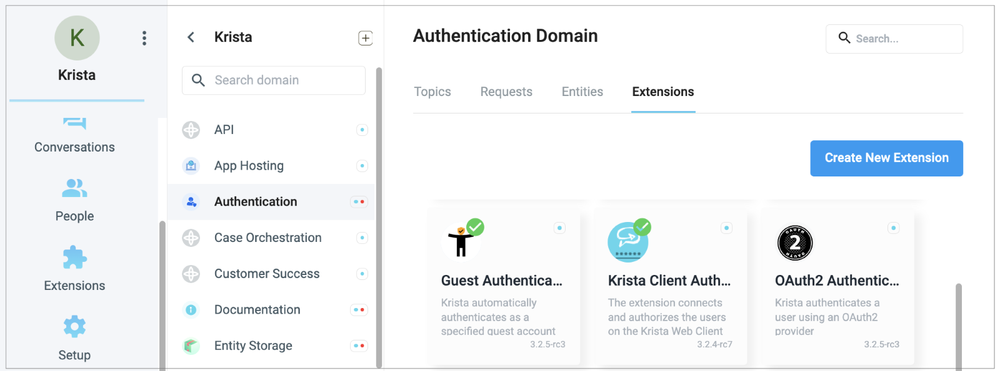
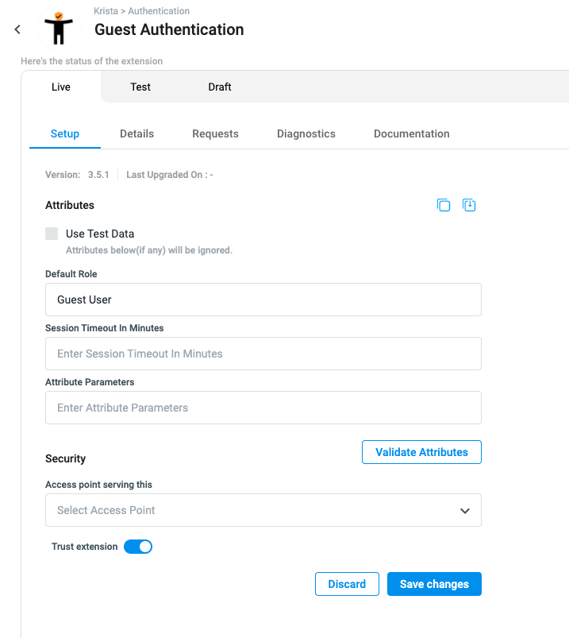
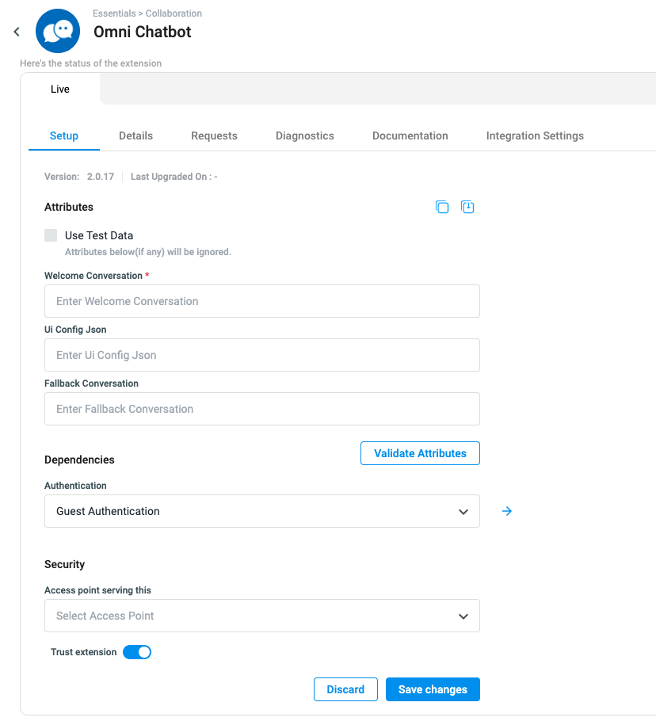
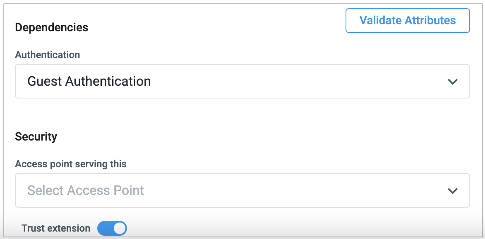

# Extension Configuration

## Overview

This guide provides step-by-step instructions for configuring the Krista Chatbot Extension with Omni-Channel functionality. The extension requires proper setup of authentication, conversation flows, UI customization, and security settings to deliver a seamless chatbot experience.

## Prerequisites

Before configuring the Chatbot Extension, ensure you have:

- ✅ Workspace administrator rights
- ✅ Access to the Krista Catalog
- ✅ Guest Authentication Extension installed and configured
- ✅ At least one welcome conversation created in live mode
- ✅ A fallback conversation created in live mode

## Configuration Parameters

| Parameter                   | Type      | Required | Description                                                                | Example                         |
|-----------------------------|-----------|----------|----------------------------------------------------------------------------|---------------------------------|
| Welcome Conversation        | Text      | Yes      | The conversation that initiates when users first interact with the chatbot | "Welcome to Krista"             |
| Fallback Conversation       | Text      | No       | Conversation triggered when user input is not recognized                   | "Fallback Handler"              |
| Authentication Dependency   | Extension | Yes      | Guest Authentication extension binding                                     | Guest Authentication            |
| Access Point                | Security  | No       | Security access point serving this extension                               | Default Access Point            |
| Trust Extension             | Boolean   | Yes      | Enable trusted extension mode                                              | true                            |

> **Important**: The UI Config Json attribute is now optional and no longer used. All chatbot UI configuration is now done through the form-based **Integration Settings** tab. Any values in the UI Config Json field won’t have any impact on the chatbot configuration.

## Step-by-Step Setup

### Step 1: Install Guest Authentication Extension

1. Navigate to **Catalog** → **Krista Ecosystem** → **Authentication Domain**

   

2. Locate the **Guest Authentication** extension
3. Update to the latest version if needed
4. Click **Add to Workspace**
5. Navigate to the extension's **Setup** page

   

6. Configure required authentication parameters
7. Click **Validate Attributes** and **Save**

### Step 2: Add Chatbot Extension to Workspace

1. Navigate to **Catalog** → **Essentials Ecosystem** → **Collaboration Domain**
2. Locate the **Omni Chatbot** extension
3. Click **Add to Workspace**
4. The related .daz file will be added to your workspace
5. Navigate to the extension's **Setup** page

   

### Step 3: Configure Welcome Conversation

The Welcome Conversation is the initial dialogue that greets users when they start interacting with the chatbot.

1. Navigate to the Chatbot Extension **Setup** page
2. In the **Welcome Conversation** field, enter the name of your welcome conversation
3. Ensure this conversation is in **live mode**
4. Ensure **Welcome Conversation** must be unique across the workspace

**Best Practices:**
- Create a friendly, engaging welcome message
- Include clear instructions on how to interact with the chatbot
- Personalize the greeting based on your use case

### Step 4: Configure UI Settings via the Integration Settings Tab

The chatbot's appearance and behavior are configured using the **Integration Settings** custom tab, which provides a user-friendly form-based interface.

> **Guidelines**:
> - First, validate and save all required configuration parameters in the **Setup** page (Welcome Conversation, Dependencies, Security settings)
> - Then, configure the chatbot UI settings from the **Integration Settings** tab

#### Accessing the Integration Settings Tab

1. Navigate to the Chatbot Extension in your workspace
2. Complete the Setup page configuration and click **Validate Attributes** and **Save**
3. Click on the **Integration Settings** custom tab
4. You'll see a form with various configuration options organized into sections

#### Configuration Sections

The Integration Settings tab provides form fields for all chatbot customization options:

**Basic Settings**
- **Bot Name**: Display name of the chatbot (e.g., "Krista")
- **Bot Subtitle**: Subtitle text shown below the bot name
- **Logo URL**: URL of the chatbot logo image

**Appearance**
- **Border Width**: Border width of a chatbot window (e.g., "1px")
- **Border Color**: Border color in hex format (e.g., "#0176D6")
- **Bot Name Position**: Choose from "left", "center", or "right"

**Theme Colors**
- **Brand Color**: Primary brand color (e.g., "#0176D6")
- **Text Color**: Text color (e.g., "#000000")
- **Divider Color**: Divider line color (e.g., "#000000")

**Custom Fonts**
- **Font Family**: Custom font family name (e.g., "Roboto")
- **Font Import URL**: Google Fonts or custom font URL

**Chatbot Bubble**
- **Bubble Name**: Text displayed on the chat bubble button (e.g., "Talk to us")
- **Bubble Position**: Position of the bubble on the screen
  - Options: `bottomRight`, `bottomLeft`, `topRight`, `topLeft`, `centerRight`, `centerLeft`
  - Default: `bottomRight`
- **Bubble Background Color**: Background color of the bubble icon in hex format (e.g., "#4fd7ed")
- **Border Width**: Border width of the bubble button (e.g., "1px")
- **Bubble Icon (SVG)**: Custom SVG code for the bubble icon
  - Accepts inline SVG markup
  - Use `currentColor` for fill/stroke to inherit the icon color
  - Example: `<svg width="26" height="21" viewBox="0 0 26 21" fill="currentColor">...</svg>`

**Behavior Options**
- **Start as Bubble**: Launch chatbot as a bubble vs. a full window
- **Is Full Size**: Occupy 100% of parent container
- **Hide Send Message**: Hide the message input box
- **Restart on Refresh**: Restart conversation when the page refreshes
- **Can Change Language**: Show language selection dropdown

**Terms & Conditions**
- **Terms & Conditions URL**: Link to your terms and conditions
- **Terms & Conditions Label**: Display text for the T&C link

**Integration**
- **Dashboard Callback URL**: Webhook URL for receiving conversation transcripts

#### Using the Form-Based Configuration

1. Ensure you’ve completed and saved the Setup page configuration first
2. Navigate to the **Integration Settings** tab
3. Fill in the desired configuration values in the form fields
4. Leave fields blank to use default values
5. Click **Save Configuration** to apply your configuration
6. The configuration is automatically validated before saving

> **Note**: The form-based approach in the Integration Settings tab has replaced the old "UI Config Json" text field. The UI Config Json attribute is now optional and kept only for backward compatibility in case of version rollback. Any changes to the UI Config Json field won’t affect the chatbot configuration.

#### UI Config Parameters (Reference)

| Parameter                  | Type    | Required | Description                          | Default       | Options                                                             |
|----------------------------|---------|----------|--------------------------------------|---------------|---------------------------------------------------------------------|
| botName                    | Text    | No       | Display name of the chatbot          | "Krista"      | Any string                                                          |
| outlineWidth               | Text    | No       | Border width of chatbot window       | "1px"         | CSS width value                                                     |
| outlineColor               | Text    | No       | Border color of chatbot window       | "#0176D6"     | Hex color code                                                      |
| logo                       | Text    | No       | URL of chatbot logo image            | -             | Valid image URL                                                     |
| theme.brandColor           | Text    | No       | Primary brand color                  | "#0176D6"     | Hex color code                                                      |
| theme.textColor            | Text    | No       | Text color                           | "#000000"     | Hex color code                                                      |
| theme.dividerColor         | Text    | No       | Divider line color                   | "#000000"     | Hex color code                                                      |
| theme.fontFamily           | Text    | No       | Custom font family                   | "Roboto"      | Font name                                                           |
| theme.fontImportUrl        | Text    | No       | Font import URL                      | -             | Google Fonts URL                                                    |
| chatBubble.text            | Text    | No       | Text displayed on chat bubble        | "Talk to us"  | Any string                                                          |
| chatBubble.position        | Text    | No       | Position of bubble on screen         | "bottomRight" | bottomRight, bottomLeft, topRight, topLeft, centerRight, centerLeft |
| chatBubble.backgroundColor | Text    | No       | Background color of bubble icon      | "#4fd7ed"     | Hex color code                                                      |
| chatBubble.borderWidth     | Text    | No       | Border width of bubble button        | "1px"         | CSS width value                                                     |
| chatBubble.icon            | Text    | No       | Custom SVG code for bubble icon      | -             | Valid SVG markup                                                    |
| startAsBubble              | Boolean | No       | Launch as bubble vs full window      | true          | true, false                                                         |
| isFullSize                 | Boolean | No       | Occupy 100% of parent container      | false         | true, false                                                         |
| hideSendMessage            | Boolean | No       | Hide message input box               | false         | true, false                                                         |
| restartOnRefresh           | Boolean | No       | Restart conversation on page refresh | false         | true, false                                                         |
| botNamePosition            | Text    | No       | Position of bot name                 | "left"        | "left", "right", "center"                                           |
| canChangeLanguage          | Boolean | No       | Show language dropdown               | false         | true, false                                                         |
| botSubTitle                | Text    | No       | Subtitle below bot name              | -             | Any string                                                          |
| TnC                        | Text    | No       | Terms and conditions URL             | -             | Valid URL                                                           |
| TnCLabel                   | Text    | No       | Label for T&C link                   | -             | Any string                                                          |
| Dashboard Callback Url     | Text    | No       | Callback URL for transcripts         | -             | Valid URL                                                           |

### Step 5: Configure Fallback Conversation

The Fallback Conversation handles unrecognized user inputs gracefully.

1. In the **Fallback Conversation** field, enter the name of your fallback conversation
2. Ensure this conversation is in **live mode**

**Fallback Conversation Best Practices:**
- Provide helpful suggestions for rephrasing
- Offer alternative actions or menu options
- Maintain a friendly, helpful tone
- Guide users back to successful interactions

**Example Fallback Messages:**
- "I didn't quite understand that. Could you rephrase your question?"
- "I'm not sure how to help with that. Here are some things I can do..."
- "Let me connect you with a human agent for assistance."

### Step 6: Configure Dependencies

Link the Guest Authentication extension as a dependency.

1. Navigate to the **Dependencies** panel
2. In the **Authentication** field, select the **Guest Authentication** extension

   

3. Ensure the Guest Authentication extension is properly configured

### Step 7: Configure Security Settings

1. Navigate to the **Security** panel
2. Select the **Access Point** that will serve this extension
3. Enable the **Trust Extension** toggle
4. This allows the extension to operate with elevated privileges

### Step 8: Validate and Save

1. Click **Validate Attributes** to verify all configurations
2. Review any validation errors and correct them
3. Click **Save** to apply the configuration
4. The chatbot extension is now ready for use

## Troubleshooting

### Configuration Validation Fails

**Cause**: Missing or invalid configuration parameters
**Resolution**:
1. Verify all required fields are filled in the Setup page
2. Check configuration values in the Integration Settings tab
3. Ensure referenced conversations exist and are in live mode
4. Verify Guest Authentication extension is properly configured

### Welcome Conversation Doesn't Trigger

**Cause**: Conversation not in live mode or incorrect name
**Resolution**:
1. Verify the conversation name matches exactly
2. Ensure the conversation is published and in live mode
3. Check conversation has no errors

### UI Customization Not Applied

**Cause**: Invalid configuration values in the Integration Settings tab or Setup page not saved
**Resolution**:
1. Ensure the Setup page configuration is validated and saved first
2. Navigate to the Integration Settings tab
3. Verify all form fields have valid values
4. Check that color codes are in proper hex format (e.g., #0176D6)
5. Ensure all URLs are valid and accessible
6. Verify CSS values (like border width) use proper units (e.g., "1px")
7. Save the configuration and refresh the chatbot preview

## See Also

- [Authentication](pages/authentication.md) - Authentication setup details
- [Context Data Passing](pages/context-data-passing.md) - Pass context to the chatbot
- [Testing the Chatbot](pages/testing-chatbot.md) - Test your configuration
