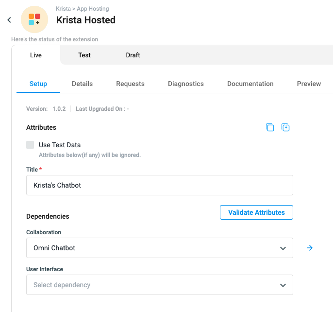
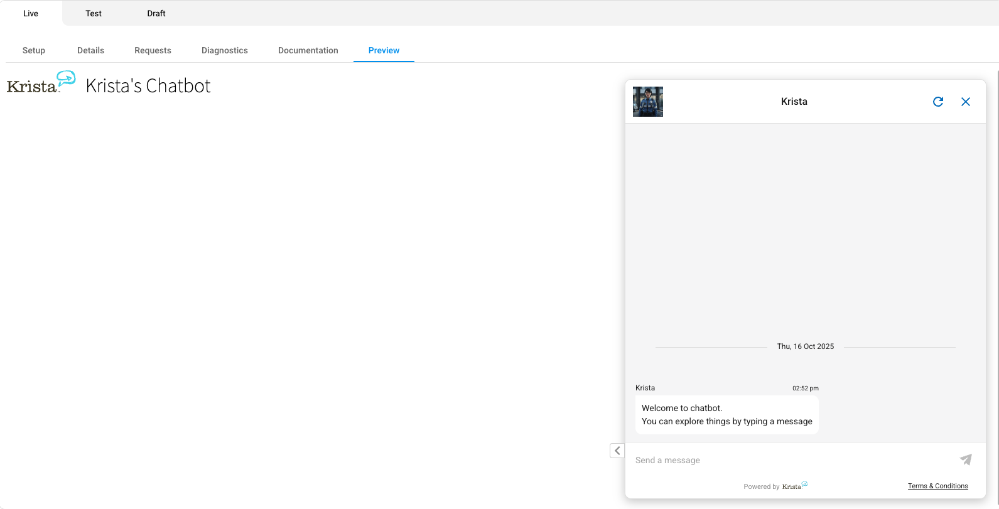

# Testing the Chatbot

## Overview

This guide provides comprehensive instructions for testing the Krista Chatbot Extension functionality using the Krista Hosted Extension. The Hosted Extension provides a convenient testing environment where you can preview and validate your chatbot configuration before deploying it to production websites.

## Prerequisites

Before testing the chatbot, ensure you have:

- ✅ Chatbot Extension installed and configured
- ✅ Guest Authentication Extension configured
- ✅ At least one welcome conversation in live mode
- ✅ Fallback conversation configured
- ✅ Workspace administrator rights

## Testing Methods

There are two primary methods for testing the chatbot:

1. **Krista Hosted Extension** - Built-in testing environment (recommended for initial testing)
2. **Custom Website Integration** - Test on your actual website (recommended for final validation)

## Method 1: Testing with Krista Hosted Extension

The Krista Hosted Extension provides a built-in preview environment for testing chatbot functionality without deploying to an external website.

### Step 1: Navigate to Hosted Extension

1. Open your Krista workspace
2. Navigate to **Catalog** → **Krista Ecosystem** → **Collaboration Domain**
3. Locate the **Krista Hosted Extension**
4. Click to open the extension

### Step 2: Configure Hosted Extension Setup

Navigate to the **Setup** tab within the Krista Hosted Extension and configure the following:

#### Configuration Parameters

| Parameter        | Description                                   | Example            |
|------------------|-----------------------------------------------|--------------------|
| **Title**        | The title displayed on the sample test site   | "Krista's Chatbot" |
| **Dependencies** | Extensions to include in the test environment | Omni Chatbot       |

#### Adding Chatbot as Dependency

1. In the **Dependencies** section, click **Add Dependency**
2. Select **Omni Chatbot** from the available extensions
3. The chatbot will now be included in the preview environment
4. Click **Save** to apply changes

### Step 3: Preview the Chatbot

1. Navigate to the **Preview** tab in the Krista Hosted Extension
2. The preview site will render with the chatbot widget embedded
3. The chatbot appearance and behavior will reflect your configuration

### Step 4: Test Chatbot Functionality

Once the preview loads, test the following functionality:

#### Basic Functionality Tests

- [ ] **Chatbot Loads** - Verify the chatbot widget appears on the page
- [ ] **Bubble Display** - Check if the chat bubble displays correctly (if `startAsBubble: true`)
- [ ] **Open Chatbot** - Click the bubble to open the chat window
- [ ] **Welcome Message** - Verify the welcome conversation triggers automatically
- [ ] **UI Customization** - Confirm theme, colors, and branding match your configuration
- [ ] **Message Input** - Test typing and sending messages
- [ ] **Bot Responses** - Verify the bot responds appropriately

#### Advanced Functionality Tests

- [ ] **Conversation Flow** - Test complete conversation workflows
- [ ] **Form Fields** - Test any forms or input fields in conversations
- [ ] **Fallback Handling** - Enter unrecognized input to test fallback conversation
- [ ] **Multi-Step Conversations** - Test conversations with multiple steps
- [ ] **Button Interactions** - Test any buttons or quick reply options
- [ ] **File Uploads** - Test file upload functionality (if applicable)
- [ ] **Language Selection** - Test language dropdown (if `canChangeLanguage: true`)

#### UI Configuration Tests

Test each UI configuration option:

| Configuration             | Test Action  | Expected Result                       |
|---------------------------|--------------|---------------------------------------|
| `startAsBubble: false`    | Load preview | Chatbot opens directly without bubble |
| `startAsBubble: true`     | Load preview | Chat bubble appears, click to open    |
| `isFullSize: true`        | Open chatbot | Chatbot fills 100% of container       |
| `hideSendMessage: true`   | Open chatbot | Message input box is hidden           |
| `restartOnRefresh: true`  | Refresh page | Chatbot restarts from beginning       |
| `canChangeLanguage: true` | Open chatbot | Language dropdown is visible          |
| `botNamePosition: "left"` | Open chatbot | Bot name aligned to left              |
| `TnC` and `TnCLabel`      | Open chatbot | Terms & Conditions link in footer     |

### Step 5: Test Error Scenarios

Test how the chatbot handles various error conditions:

#### Error Scenario Tests

1. **Invalid Input**
   - Enter gibberish or invalid data
   - Verify fallback conversation triggers
   - Confirm helpful error messages

2. **Session Timeout**
   - Wait for a session timeout period
   - Attempt to send a message
   - Verify appropriate handling

3. **Network Issues**
   - Simulate slow network (browser dev tools)
   - Verify loading indicators appear
   - Test message retry functionality

4. **Empty Messages**
   - Try sending empty messages
   - Verify validation prevents submission

## Method 2: Testing on a Custom Website

After validating with the Hosted Extension, test the chatbot on your actual website.

### Step 1: Get Integration Script

Use the [Get Script Element](pages/get-script-element.md) catalog request to generate the integration script for your website.

### Step 2: Embed on Test Page

1. Create a test HTML page on your website
2. Add the generated script to the page
3. Include any context data you want to pass (see [Context Data Passing](pages/context-data-passing.md))

### Step 3: Test in Different Browsers

Test the chatbot in multiple browsers:

- [ ] **Chrome** (latest version)
- [ ] **Firefox** (latest version)
- [ ] **Safari** (version 16.3 or above)
- [ ] **Edge** (latest version)
- [ ] **Mobile Safari** (iOS)
- [ ] **Mobile Chrome** (Android)

### Step 4: Test Responsive Design

Test the chatbot on different screen sizes:

- [ ] **Desktop** (1920x1080 and above)
- [ ] **Laptop** (1366x768)
- [ ] **Tablet** (768x1024)
- [ ] **Mobile** (375x667 and smaller)

### Step 5: Test Context Data Passing

If you're passing context data:

1. Verify context variables are populated correctly
2. Test conversations that use context data
3. Verify personalization works as expected
4. Check the browser console for any errors

## Common Test Scenarios

### Scenario 1: Customer Service Chatbot

**Test Flow:**
1. User opens chatbot
2. Welcome message greets user
3. User asks a common question
4. Bot provides relevant answer
5. User asks a follow-up question
6. Bot maintains context and responds appropriately

**Validation:**
- The welcome message is friendly and clear
- Bot understands common questions
- Responses are accurate and helpful
- Conversation flow is natural

### Scenario 2: Form Submission

**Test Flow:**
1. User opens chatbot
2. Bot prompts for information
3. User fills out form fields
4. User submits form
5. Bot confirms submission

**Validation:**
- Form fields display correctly
- Validation works for required fields
- Error messages are clear
- Submission confirmation is received

### Scenario 3: Fallback Handling

**Test Flow:**
1. User opens chatbot
2. User enters unrecognized input
3. Fallback conversation triggers
4. Bot provides helpful guidance
5. User is redirected to valid options

**Validation:**
- Fallback triggers appropriately
- Fallback message is helpful
- User can recover and continue
- No error messages displayed

## Troubleshooting Test Issues

### Chatbot Doesn't Load in Preview

**Cause**: Configuration error or dependency not set
**Resolution**:
1. Verify Omni Chatbot is added as dependency in Hosted Extension
2. Check Chatbot Extension is properly configured
3. Ensure Guest Authentication is configured
4. Review the browser console for errors

### Welcome Conversation Doesn't Trigger

**Cause**: Conversation not in live mode or incorrect name
**Resolution**:
1. Verify welcome conversation name matches configuration
2. Ensure the conversation is published and in live mode
3. Check conversation has no errors
4. Test conversation independently first

### UI Customization Not Applied

**Cause**: Invalid configuration values or caching issue
**Resolution**:
1. Verify configuration values in the Integration tab
2. Clear browser cache and reload
3. Check for typos in configuration fields
4. Verify all URLs (logo, fonts) are accessible
5. Ensure color codes are in proper hex format

### Session Expires Too Quickly

**Cause**: Session timeout set too low
**Resolution**:
1. Review session timeout in Guest Authentication
2. Increase timeout value if appropriate
3. Upgrade and validate Chatbot Extension
4. Test again with a new timeout

### Context Data Not Working

**Cause**: Metadata not passed correctly
**Resolution**:
1. Verify `metadata` property name is used
2. Check data is initialized before chatbot init
3. Verify data types are supported
4. Review the browser console for errors

## Testing Checklist

Use this checklist to ensure comprehensive testing:

### Configuration Testing
- [ ] Extension installed and configured
- [ ] Authentication dependency set
- [ ] Welcome conversation configured
- [ ] Fallback conversation configured
- [ ] UI configuration completed in Integration tab

### Functional Testing
- [ ] Chatbot loads successfully
- [ ] Welcome message displays
- [ ] People can send messages
- [ ] Bot responds appropriately
- [ ] Conversations flow correctly
- [ ] Forms work properly
- [ ] Fallback handles unknown input
- [ ] Session persists appropriately

### UI Testing
- [ ] Theme colors applied correctly
- [ ] Logo displays (if configured)
- [ ] Font family applied (if configured)
- [ ] Bot name positioned correctly
- [ ] Subtitle displays (if configured)
- [ ] Terms & Conditions link works (if configured)
- [ ] Language selector works (if enabled)
- [ ] Responsive on all screen sizes

### Browser Testing
- [ ] Works in Chrome
- [ ] Works in Firefox
- [ ] Works in Safari 16.3+
- [ ] Works in Edge
- [ ] Works on mobile devices

### Integration Testing
- [ ] Script element generates correctly
- [ ] Embeds on external website
- [ ] Context data passes correctly
- [ ] CORS policy allows access
- [ ] HTTPS works properly

### Performance Testing
- [ ] Chatbot loads quickly
- [ ] Messages sent / received promptly
- [ ] No memory leaks
- [ ] Works with a slow network

## Best Practices for Testing

### 1. Test Early and Often
- Test after each configuration change
- Don't wait until full deployment
- Catch issues early in development

### 2. Test with Real Data
- Use realistic conversation scenarios
- Test with actual user questions
- Include edge cases and error conditions

### 3. Test Across Environments
- Test in Hosted Extension first
- Then test on a staging website
- Finally, test in production

### 4. Document Test Results
- Keep track of what works and what doesn't
- Document any issues found
- Note browser-specific behaviors

### 5. Involve Real Users
- Conduct user acceptance testing
- Gather feedback on conversation flow
- Iterate based on user input

## Next Steps After Testing

Once testing is complete and successful:

1. **Document Configuration** - Record all settings and configurations
2. **Deploy to Production** - Embed chatbot on a production website
3. **Monitor Performance** - Track usage and performance metrics
4. **Gather Feedback** - Collect user feedback for improvements
5. **Iterate and Improve** - Continuously refine conversations and configuration

## See Also

- [Extension Configuration](pages/extension-configuration.md) - Configure the chatbot
- [Context Data Passing](pages/context-data-passing.md) - Pass context data
- [Get Script Element](pages/get-script-element.md) - Generate integration script
- [Get Session Id for Active User](pages/get-session-id-for-active-user.md) - Session management
